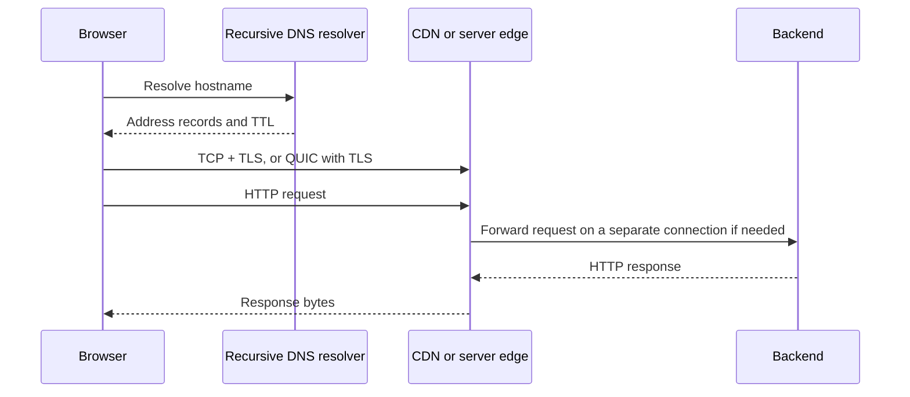

# DNS, TLS, and HTTP

Typing `https://relay.example/tasks` names a service and resource, not a particular machine. The browser must find an endpoint, establish protected communication, and exchange an application message. Caches and existing connections can skip work, so the following is a cold-path explanation rather than an invariant sequence for every request.

## DNS delegates naming

The browser, OS, and recursive resolver may each cache DNS data. On a miss, the recursive resolver follows delegations: root servers point toward the top-level domain, which points toward authoritative servers for the domain. Authoritative records answer for the zone. A recursive resolver does this work on the client's behalf; the browser usually does not query every layer itself.

`A` and `AAAA` records provide IPv4 and IPv6 addresses. Other records, including aliases, influence resolution. TTL expresses how long an answer may be cached, not an exact instant when all clients worldwide switch. Old answers can remain in existing connections; resolver behavior and negative caching matter too. A DNS change alone is therefore a poor immediate revocation mechanism.

## TLS establishes a protected channel

The server presents a certificate chain. The client checks a chain to an accepted trust anchor, the intended hostname, validity periods, and applicable policy. A certificate authority attests a binding under its issuance process; it does not certify that the application's business logic is honest. A valid certificate for an attacker's domain does not make that domain yours.

The handshake establishes keys and authenticates the server; client certificates can optionally authenticate clients. Modern TLS uses authenticated encryption for application data. The certificate's public key is not simply used to encrypt every response. HTTPS means HTTP protected by TLS on the relevant connection. If TLS terminates at a proxy, the proxy-to-backend connection is a separate trust boundary that needs its own policy.

Never disable certificate verification to “fix HTTPS.” Diagnose hostname mismatches, expired certificates, missing chains, or trust-store problems. Encryption without authenticated peer identity can securely carry bytes to the wrong party. See [trust boundaries](../08-security/trust-and-authorization.md).

## HTTP semantics outlive transport versions

An HTTP request includes a method, target, fields/headers, and optionally content. Responses include a status and representation metadata. `GET /tasks/42` names an operation on a resource; a `200` response says that HTTP operation succeeded, not that every downstream business event has already completed.

HTTP/1.1 commonly reuses a TCP connection for multiple requests. Without effective pipelining, concurrent requests usually require multiple connections. HTTP/2 multiplexes streams on a connection and compresses headers, but TCP packet loss can delay delivery across streams. HTTP/3 maps HTTP to QUIC streams, reducing that particular cross-stream blocking. None removes server queues, bandwidth limits, or application dependency chains.

**Keep-alive** means a connection is reusable; it is distinct from transport keepalive probes and application heartbeats. **Connection pooling** manages reusable connections with limits, idle expiration, and acquisition behavior. Reuse saves handshakes, but a stale pooled connection can fail and too many pools can overwhelm the destination. Pool wait belongs in request latency telemetry.

## Caching and conditional requests

Caching stores a response representation under a cache key. Freshness determines whether it can be reused without checking the origin. An `ETag` is a representation validator: `If-None-Match` allows a `304 Not Modified` response without retransmitting the representation. A `304` still costs a round trip. `no-cache` allows storage but requires validation before reuse; `no-store` instructs caches not to store the response. These are different directives.

`Vary` identifies request headers that affect representation selection. Forgetting a language or encoding dimension can return the wrong variant. Personalized responses require explicit cache policy and correct keying; an accidental shared cache entry can leak data. The full correctness discussion is in [cache design](../07-caching/cache-design.md).

## Failure reasoning

A page can be slow because of DNS, connection establishment, TLS, server wait, download, or rendering. A network waterfall exposes these phases. Repeated “DNS took zero” may reflect caching, not an impossibly fast resolver. A timeout before headers cannot tell you whether a mutation committed. A TLS error is not an HTTP 500 because no valid HTTP exchange may have occurred.

Why not open a new connection for every request? It spends handshake latency, CPU, sockets, and congestion ramp-up. Why not keep all connections forever? Deployments, address changes, NAT expiry, and finite capacity make lifecycle management necessary.

## Exercises

1. **Predict:** DNS TTL is 60 seconds. Why might a client still contact the old server after two minutes?
2. **Debug:** Explain how a personalized page can leak through a CDN even though HTTPS is enabled.
3. **Implementation:** Observe a page reload in browser developer tools with cache enabled and disabled. Identify reuse, validation, and full downloads.
4. **Interview:** Explain why HTTP/2 multiplexing does not eliminate all head-of-line blocking.

Hints

Existing connections can outlive DNS records. HTTPS protects transport; the cache must independently preserve authorization and representation boundaries. Separate application-stream blocking, transport delivery blocking, and server-side queues.

## Further reading

[RFC 9110: HTTP semantics](https://www.rfc-editor.org/rfc/rfc9110), [RFC 9111: caching](https://www.rfc-editor.org/rfc/rfc9111), [RFC 8446: TLS 1.3](https://www.rfc-editor.org/rfc/rfc8446), and [RFC 1034: DNS concepts](https://www.rfc-editor.org/rfc/rfc1034) are the primary specifications. [The request journey](../12-fullstack/the-life-of-a-request.md) connects these layers to code.
