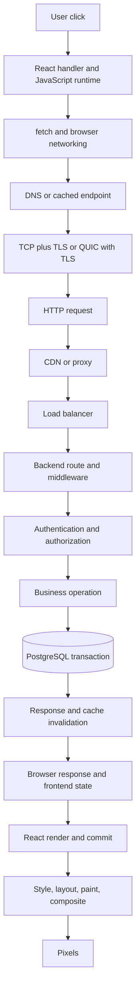

# The life of a request

Follow one action: a user changes Relay task 42's title and presses Save. The useful mental model is a chain of ownership transfers. At each boundary, ask what is known, what is merely assumed, how long work can wait, and what survives a crash.

## 1. Intent becomes asynchronous work

The browser dispatches the click event. React's handler sees the state snapshot associated with that render, validates local form feedback, and initiates a mutation. It records pending state and a stable operation identity if retries need one. The handler should not rely on disabling the button as the only duplicate-prevention mechanism; another tab or network retry can still duplicate the request.

Calling `fetch` hands network work to browser facilities and returns a promise. JavaScript does not spin waiting for packets. Promise continuations run when scheduled after completion. The UI can remain responsive if the handler and subsequent calculations are bounded. A huge synchronous serialization step can block before the request even leaves.

## 2. The browser resolves policy and transport

The browser resolves the URL, applies origin/credential rules, and may perform a CORS preflight. Cookies matching the request's policy are drawn from the cookie jar; application code cannot manually set every forbidden browser-managed header. A same-origin request and a cross-origin credentialed request have different policy requirements.

DNS resolution may use cached answers. A usable connection may already exist. Otherwise the browser establishes TCP and TLS, or QUIC with its integrated TLS handshake for HTTP/3. Certificate verification authenticates the intended endpoint. DNS, connection, TLS, and request timing are separate latency components, as [networking](../03-networking/dns-tls-http.md) explains.

## 3. Intermediaries route and constrain

The CDN normally should not satisfy this authenticated mutation from a shared cache. It may terminate TLS, enforce limits, and forward to an origin. A load balancer selects a healthy API replica. Each hop can have its own connection pool, timeout, buffering, and request-size policy.

The API trusts forwarded identity/IP information only from configured infrastructure. A trace context can connect spans, but untrusted tracing headers must not grant authority or permit unlimited telemetry cardinality. Time spent waiting at a proxy or for a backend connection belongs in the end-to-end budget.

## 4. The backend establishes authority

The server parses bounded input, matches a route, authenticates the session, validates the title, loads the task's workspace context, and checks edit permission. The user-supplied task ID identifies a candidate resource; the verified principal and current policy determine access.

The operation acquires a database connection from a bounded pool. Pool wait is distinct from SQL execution. A conditional update uses the submitted base version to prevent silently overwriting another edit. If membership changes concurrently, the application needs a deliberate policy for the authorization-check/update boundary, potentially within a transaction using appropriate coordination.

## 5. Durable state changes before notification

PostgreSQL finds rows through a plan, reads relevant pages, coordinates concurrent updates, and records changes under its WAL/durability policy. If the update changes zero rows because the version is stale, return a conflict rather than pretending success. If it commits, that fact survives the configured failure model even if the API crashes before responding.

If a task-updated event must not be lost, write an outbox record in the same transaction. A relay later publishes it, potentially more than once. Deleting or refreshing cache entries changes derived representations; it must not redefine whether the database operation committed. A failed cache invalidation is a repair/freshness problem with its own telemetry.

## 6. Bytes return; the browser updates knowledge

The backend serializes only intended fields and returns the authoritative version. HTTP failure status does not necessarily reject a `fetch` promise; code must inspect `response.ok` or status and parse the expected error contract. Network rejection or timeout can leave the mutation outcome unknown.

The client reconciles the response with the correct workspace/query/mutation identity. An obsolete response must not overwrite a newer view. It updates or invalidates relevant server-state cache entries and clears pending state. A permission error may require removing sensitive stale content; a transient network error may preserve a retryable draft.

## 7. State becomes pixels

React calculates the next description, reconciles identity, and commits selected DOM changes. The browser determines needed style, layout, paint, and compositing work. A render does not imply all stages run or that every DOM node changes. The user's perceived completion includes visual feedback and accessibility announcements, not merely the API's response timestamp.

## Where five seconds can disappear

Break the journey into browser scheduling, DNS/connect/TLS, edge wait, backend admission, pool acquisition, authorization, SQL/locks, serialization, download, and render. A trace may cover only the server part; browser performance data completes the story. Parallel spans overlap, so the critical path matters more than summing all durations. A slow response body consumed late can also retain server/client resources after headers arrive.

## Exercises

1. **Draw:** Reproduce the journey without notes and label every cache, trust boundary, and queue.
2. **Predict:** The database commits but the browser sees a timeout. Which UI states and retry mechanisms remain truthful?
3. **Debug:** The server reports 80 ms but the user sees two seconds. Propose measurements for the missing interval.
4. **Implementation:** Attach a request ID and trace a local mutation from browser timing to pool wait and SQL, then profile the resulting render.
5. **Interview:** Explain the same journey in five minutes, then spend ten minutes on one failure boundary.

Review criteria

A strong explanation separates intent, acceptance, durable commit, response receipt, cache freshness, and rendered feedback. It does not infer rollback from timeout or authorization from a hidden UI control.

## Further reading and connections

[Fetch standard](https://fetch.spec.whatwg.org/), [React render and commit](https://react.dev/learn/render-and-commit), and [OpenTelemetry traces](https://opentelemetry.io/docs/concepts/signals/traces/). Continue to [login/data flows](authentication-and-data-flows.md), [outbox](../20-production-patterns/outbox-inbox-and-sagas.md), and [incident diagnosis](../21-case-studies/incident-lab.md).
