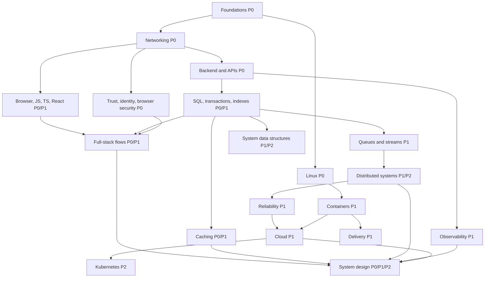

# Learning roadmap

Use prerequisites as a dependency graph, not a demand to master every advanced topic before writing an application. Sections 04–08 overlap: learn enough of each to build the first complete vertical slice, then return for their deeper chapters. The per-section indexes list every chapter with its priority; optional specialist work is P3.

## Level 0 — Foundations

Prerequisite: write functions, use collections, and reason about basic complexity. Read [foundations](01-foundations/README.md) **P0**, then [Linux](02-operating-systems-linux/README.md) **P0**. Explain why an asynchronous server can still freeze on CPU work. Inspect a process, its memory, open files, and listening sockets. Exit evidence: a small producer/consumer experiment with bounded memory, plus a timeline of a race.

## Level 1 — Web development foundations

Prerequisite: Level 0's process, byte, and concurrency models. Read [networking](03-networking/README.md) **P0/P1**, the first four [frontend chapters](04-frontend/README.md) **P0**, [backend and APIs](05-backend/README.md) **P0/P1**, and [security](08-security/README.md) **P0**. Begin [relational modeling](06-databases/relational-model.md) **P0** here. Exit evidence: explain DNS through HTTP, render a semantic form, validate its input on the server, and enforce authorization on its database access.

## Level 2 — Production applications

Prerequisite: a working HTTP endpoint and a basic SQL query. Finish React, state, rendering, performance, and testing in [frontend](04-frontend/README.md) **P0/P1**. Study [databases](06-databases/README.md) **P0/P1**, [caching](07-caching/README.md) **P0/P1**, [full-stack flows](12-fullstack/README.md) **P0/P1**, and [containers](15-containers/README.md) **P1**. Complete [Project 1](projects/01-production-crud-api.md) **P0** and [Project 2](projects/02-full-stack-relay.md) **P1**. Exit evidence: concurrency-safe changes, keyboard-accessible UI, tested authentication, documented freshness, and reproducible startup.

## Level 3 — Scaling

Prerequisite: understand transactions and the single-server application's measured limits. Read [messaging](09-messaging-streaming/README.md) **P1**, [system data structures](11-system-data-structures/README.md) **P1/P2**, [observability](14-observability/README.md) **P1**, and [production patterns](20-production-patterns/README.md) **P1/P2**. Revisit replication, CDNs, and cache failures. Complete [Project 3](projects/03-background-processing.md) **P1**. Exit evidence: explain what is durable at each acknowledgement and demonstrate recovery after a worker crash.

## Level 4 — Distributed systems

Prerequisite: network timeouts, database isolation, and queue acknowledgements. Read [distributed systems](10-distributed-systems/README.md) **P1/P2** in order. Do not skip leases or clock assumptions. Draw histories showing both safety and liveness. Exit evidence: distinguish timeout from failure, explain a stale lease holder, and state exactly what a quorum proves. Implement a small deterministic failure simulator as **P3** work only after you can explain the model.

## Level 5 — Production infrastructure

Prerequisite: a containerized application, useful telemetry, and a partial-failure model. Read [reliability](13-reliability/README.md) **P1**, [cloud](16-cloud/README.md) **P1**, [Kubernetes](17-kubernetes/README.md) **P2**, and [CI/CD](18-ci-cd/README.md) **P1**. Complete [Project 4](projects/04-realtime-chat.md) **P1** and [Project 5](projects/05-scalable-service.md) **P2**. Exit evidence: a restore drill, safe schema migration, load test with overload, and rollback with a user-facing success criterion.

## Level 6 — System design and synthesis

Prerequisite: the previous exit evidence, not just recognition of component names. Follow [system design](19-system-design/README.md) **P0/P1/P2**, [case studies](21-case-studies/README.md) **P1**, and [interview preparation](22-interview-preparation/README.md) **P1**. Start each design with requirements, estimates, and invariants. Explain what you deliberately leave out. Exit evidence: an unfamiliar design defended against failures, a five-minute request trace, and a ten-minute incident diagnosis.

## Pacing and specialization

A useful study session is 60–120 minutes: retrieval, reading, one experiment, and a written explanation. Schedule by checkpoint results rather than a promised completion date. A frontend emphasis spends extra sessions on browser/React/performance and still completes SQL/security/request tracing. A backend emphasis spends extra sessions on transactions/queues/reliability and still completes browser origin rules and frontend state. Specialist **P3** extensions include consensus proofs, storage-engine implementation, compiler internals, kernel tracing, and custom Kubernetes controllers; the core course gives prerequisites and exercises without pretending these are quick topics.
